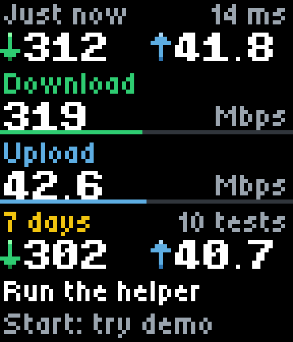

# Net Speed

An internet speed test for the [BUSY Bar](https://busy.app). Tap Start, watch
download and upload being measured, and flip through your history with the
wheel: last test, averages for 24 hours, 7 days and 30 days, fastest and slowest.



## It needs a helper on a computer

A BUSY Bar can't test your connection by itself. An app on the bar moves data at
under 1 Mbps (measured on firmware 1.4.1), so a test run on the bar would
measure the bar, not your internet.

Net Speed splits the job:

- **The app on the bar** is the button and the screen.
- **The helper** is one small Python file you run on a computer on the same
  network: a Mac, a Windows or Linux PC, a Raspberry Pi. It runs the test and
  keeps the results. A wired computer gives the truest numbers.

No helper yet? The app has a demo: press Start on the setup screen, or turn on
**Demo data** in the app's settings.

## Set it up

1. **Install the app.** From the BUSY Apps Catalog, or download
   [`io.github.maxugc.netspeed.tgz`](https://github.com/maxugc/busybar-net-speed/releases/latest/download/io.github.maxugc.netspeed.tgz)
   from this repository's Releases, open your bar's web page, go to **Apps**,
   click **+ Add app**, upload the file, then click **Install app** to confirm.
2. **Run the helper.** Download [`netspeed_helper.py`](https://github.com/maxugc/busybar-net-speed/releases/latest/download/netspeed_helper.py)
   (the same file as [`helper/netspeed_helper.py`](helper/netspeed_helper.py) in
   this repository) and start it. It needs Python 3.8 or newer and nothing else.

   ```sh
   python3 netspeed_helper.py
   ```

   It finds the bar (over USB, at `busybar.local`, or by looking around your
   network) and tells the app where it is. Leave it running.
3. **Open Net Speed on the bar and press Start.**

If the helper can't find the bar, give it the address. If your bar's HTTP API
has a password, give it that too:

```sh
python3 netspeed_helper.py --bar 192.168.1.42 --password 1234
```

If your computer has a firewall, allow Python to accept incoming connections
on port 8791, or the bar can't reach the helper.

| Option | What it does |
|---|---|
| `--bar ADDRESS` | The bar's address, when it isn't found by itself |
| `--password KEY` | The bar's HTTP API password, if you set one |
| `--port N` | Port the app reaches the helper on (default 8791) |
| `--engine ookla` | Use Ookla's Speedtest CLI instead of the built-in test (see below) |
| `--data FOLDER` | Where results are kept (default `~/.busybar-net-speed`) |
| `--once` | Run one test in the terminal and exit |

To keep it running after a restart, add it to your system's startup items:
a LaunchAgent on macOS, a systemd service on Linux or a Raspberry Pi, Task
Scheduler on Windows.

## What you see

| Button | What it does |
|---|---|
| Start | Run a test. On the setup screen, start the demo. After a problem, try again. |
| Wheel | Last test, 24 hours, 7 days, 30 days, fastest, slowest |
| Back | Exit |

During a test the bar shows ping, then download, then upload, with live numbers
and a progress bar, then the result. The back screen adds decimals, jitter and
the range of your results.

**"Measuring..." instead of a live download number.** On a small computer and
a very fast line, the download can use the helper's whole network card. On a
Raspberry Pi 4 on a gigabit line, nothing else reached the Pi for those
seconds. The helper checks for this during every test and tells the app, which
then shows the download by the clock and picks up live numbers again for the
upload. The result is unaffected.

## The two test engines

- **Built-in (default).** Measures against Cloudflare's public speed test with
  several connections at once. Nothing to install. Cloudflare limits how much
  one address may test: on very fast lines it can refuse tests for a few minutes
  after one or two runs. The app then shows "Test server is busy" and saves
  nothing, since a throttled number would be wrong.
- **Ookla's Speedtest CLI (`--engine ookla`).** For very fast lines, or if you
  prefer it. Install it yourself from [speedtest.net/apps/cli](https://www.speedtest.net/apps/cli)
  and run `speedtest` once to read and accept Ookla's license, which allows
  personal, non-commercial use. The helper never accepts it for you.

A speed test moves as much data as your line can carry for about 15 seconds:
around 100 MB on a 50 Mbps line, and 1 to 2 GB on a gigabit line.

## Privacy

- Results stay in a file on the computer that runs the helper.
- Test traffic goes to Cloudflare, or to Ookla's servers with `--engine ookla`.
  Nothing is sent to the author of this app.
- The helper answers on your local network without a password. All it can do
  is run a test and report results.

## Build

Needs Node 24.

```sh
npm install
npm run build                                  # dist/io.github.maxugc.netspeed.tgz
npm run app:install -- --addr <bar address>    # leave out --addr over USB
npm run app:run -- --addr <bar address>
```

`tools/deploy.sh [bar address]` does the same without Node tooling. The whole
app is `src/main.js`; `tools/make_art.py` draws the icons and arrows.

How the two halves talk: the helper writes its address into the app's storage
on the bar (`helper.json`, through the bar's storage API), and the app calls
the helper's `/run`, `/status` and `/stats` over HTTP.

## Notes for BUSY Bar developers

Found while building this on firmware 1.4.1:

- An app's `fetch` tops out under 1 Mbps, whatever the method: HTTPS or plain
  HTTP, streamed, one connection or four. Large replies can arrive cut short.
- Uploading a 200 KB body from an app restarted the bar.
- An app can call other machines on the local network over plain HTTP.
- Files written to `/ext/apps_data/js_apps/<app id>/` through the bar's storage
  API are readable by the app as `/ext/data/...`, which is how a program on a
  computer can hand data to an app.
- Keep requests to the bar one at a time, and keep requests to anything that
  may not answer on a separate queue from drawing, or the screen freezes while
  a request waits.

## License

MIT, see [LICENSE](LICENSE). Speedtest is a trademark of Ookla, LLC. This
project is not affiliated with Ookla, Cloudflare or Flipper Devices.
